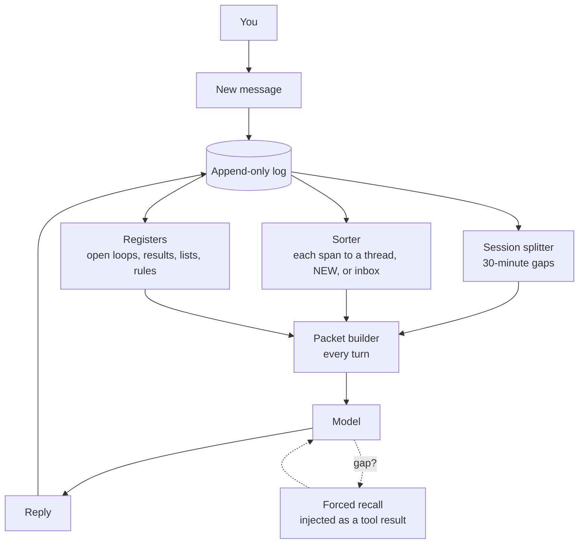

# Architecture

## How a turn works

Nothing is summarized away. The packet is rebuilt from the log on every turn, and anything it missed can be pulled back in.

## Fresh context: the core bet

The model never sees a running transcript. Every turn the context is rebuilt from scratch, so nothing grows and nothing ever gets compacted. That's what makes the chat endless.

- **A normal chat** sends the whole conversation every turn. It grows until it has to be summarized, and summaries lose things, like a standing rule.
- **Long Con** treats every message as brand new, then pulls in only what that message needs: your rules, the state of the threads it touches, and the raw words from the past that matter.
- **So the packet builder is the product.** Choosing what goes in, and what stays out, within a fixed size is the core problem, not a side detail.

## Storage

- **Append-only log.** Every turn gets a permanent global ID when it's written, and nothing is ever edited or renumbered. It is the source of truth; everything else is a cache that can be rebuilt from it.
- **Sessions** split on gaps of 30 minutes or more. They're only a display grouping, so re-splitting them can't break anything.
- **Spans, not turns.** Pointers address a turn ID plus a sentence or character range, because one message often covers several topics.
- **Threads have stable IDs with aliases,** never free-text names, so three different names for the same project stay one thread.
- **Span-to-span links.** The sorter records "this span continues that earlier span", and a thread is a connected group of linked spans. Merging and splitting are just adding or removing links, and user corrections become permanent "together" or "never together" rules.
- **Pick, don't invent.** The sorter pulls a few candidate threads and must choose one of them, NEW, or the unsorted inbox, quoting its evidence. Unsure beats wrong.
- **State files and status lines are a cache.** Every claim in them points back at a span, so drift can be caught. Thread state keeps a timeline: what was decided, what got rejected or replaced, and what you changed your mind to, each with a date and a pointer, so it knows where you landed and not just what you once said.
- **Registers.** Open loops, results, lists and rules are tagged when a turn is written, so "go", "yes" or "now do all that" resolve deterministically.
- **Multi-label topics.** A message can carry several topic labels, since one message often touches more than one subject.
- **Negative replies.** "No", "that didn't work" and "not that one" mark the idea or answer they reply to as rejected or superseded. The packet leaves it out, so shot-down ideas don't come back as false memories.
- **Cheap tagging.** Labels come from the reply call's structured output or a tiny classifier, never a separate model call per message. They stay only if they beat plain retrieval in the evals.

Where the log lives and syncs is still open: see [research/history-storage.md](research/history-storage.md).

## The context packet

Built fresh every turn, stable part first so prompt caching still works:

1. **Pinned rules,** word for word. The stable prefix, cached across turns.
2. **Thread state** for the threads this message touches, where every claim cites a pointer to raw spans.
3. **Raw spans** pulled in by retrieval and by pointers.
4. **Topic window:** the current topic's stretch of conversation, then the new message.

### Retrieval order

Search is the last resort. Most turns should be filled before anything is searched.

1. **Resolve.** A deterministic resolver turns follow-ups like "multiply it by 32" into a standalone query using the registers. Often the registers answer it outright and nothing needs searching.
2. **Registers.** Rules, open loops and recent results go straight into the packet.
3. **Search what's left.** Hybrid BM25 plus embedding search over topic segments that a tiny online splitter makes as you chat. Each segment is indexed three ways: your words, the assistant's words, and both ([threader.md](research/threader.md)).
4. **Filter and trim.** Drop anything marked rejected or superseded, boost label matches, rerank, then trim inside each segment to the hit messages plus a neighbor or two. A hit on a question pulls in its answer.
5. **Fill** the packet to budget.

Choosing what goes in:

- **Lean by default.** The packet holds only what this message needs, not a big budget filled up, and the recall slot catches anything it missed. Rules and the topic window are protected; everything else is ranked by relevance and cut to fit.
- **Retrieval every turn.** Cheap keyword or embedding search over all thread states and raw spans runs on every message, so "that thing from earlier" still lands after a long tangent. Recency only boosts; it never decides alone.
- **Lookup, not a full index.** The packet never carries a list of every thread, which would grow and break caching. The model can search for any thread the packet missed.
- **Topic window.** While you stay on one topic, that stretch rides along like a normal chat. When the topic shifts, the old stretch drops out and the new topic's state and spans come in. A long single-topic stretch still gets a size cap. When it's unclear whether the topic shifted, keep going: a false shift that drops context mid-thought is worse than carrying a little extra. A message that touches two topics brings both.

Whether to keep the topic window at all, or build a fully fresh packet every turn, is an open question to settle with evals.

## Every packet source is also a tool

The packet is a head start, never the only path. Anything the builder can look up, the model can look up too, so when it thinks the packet is incomplete, irrelevant or wrong it can try for itself. A packet can be wrong because of how the message was phrased or because the resolver guessed wrong.

| Packet source | Matching tool |
| --- | --- |
| Topic labels | Look up spans by label |
| References and their resolution | Resolve a reference, or see what the resolver picked and why |
| Past questions and answers, open questions | Find the answer to an earlier question; list open questions and loops |
| Registers: rules, results, lists | Read a register |
| Chat history | Search the whole chat |
| Memory and facts | Search memory and facts |
| Files | Find, read and edit files |

A tool call right after the packet marks a packet miss. Those calls are logged, so the evals can see what the packet should have held.

## Filling gaps mid-turn

A lean packet will sometimes miss something that matters. Three ways to catch it, most favoured first:

1. **Tool-result injection.** Every model API lets the harness write tool results, so a tool result is a legitimate way to slip in missing context. Don't depend on the model noticing its own gaps: the harness forces a recall call at the start of every turn and fills the result with whatever looks missing. When the model calls recall on its own, that's a bonus injection point. The recall tool's input is the model's own list of gaps, plus a harness check.
2. **Restart on a gap.** Watch the streamed thinking. If it signals a gap, stop, append the fact to the end of the packet so the cached prefix still holds, and start again. Cap it at one or two restarts per turn.
3. **Reviewer gate.** A second model with the big context checks the draft for missing pieces or broken rules before it goes out. Most expensive, so only on turns that matter.

A fast picker pipeline can race the main model: instant search first, then a cheap model picks what to inject.

The screen can show more than the model sees: the UI shows every thread in play, while the model gets only what the current message is about, plus whatever gets injected.

## Rules and hooks

Standing instructions are never lost to compaction, and the harness enforces them so the model doesn't have to remember.

- **A self-curating rules file.** Saying you want or hate something naturally ("always do X", "never do Y") turns it into a standing rule. You never write or curate the file yourself.
- **Hooks, not memory.** A rule like "always run this before you build" becomes a hook that fires automatically, like a git pre-commit hook. The model can forget all it wants; the step still runs.
- **Pinned rules.** Rules that can't be hooks (tone, style) go into every packet word for word. Never summarized, never decayed.
- **Scope.** If the wording clearly points at one project or clearly applies everywhere, it applies that way. If it could go either way, it asks once. Every rule can be turned off.
- **Visible and vetoable.** A small "added a rule" note shows when one is created, with one-tap undo.

Why this matters: after a compaction, a standing "run this before every build" rule was once silently dropped. Things broke in a way that wasn't obvious, and it took a while to track down.

## Open loops and the archive

Anything the assistant offers or says it will do becomes an open loop. Loops never get silently dropped, and you never have to say no.

- **Always in the packet.** Open loops ride along every turn, so "go", "yes" or "now do all that" resolve against them. "All that" means every open offer since the last go, not just the latest.
- **Ignoring isn't no.** You might have interrupted before hearing it, or skimmed past it. In voice the harness knows where you cut in, so anything after that was never heard.
- **Brought up gently.** Unseen offers come back once, bundled, at a natural break, then live in the sidebar.
- **Last call, then archive.** After one or two unanswered mentions: "Last time I'll bring this up. If you don't say anything, I'll archive it." One tap keeps it. Silence archives it, which is reversible, never a delete. There is no snooze.
- **The archive stays searchable.** Circling back to something already explored gets "we dug into this on the 12th and landed on X; want a quick recap, or start fresh?" Starting fresh blocks that archived material from the packet for that topic until you ask for it, so old conclusions don't leak back in.
- **Doing nothing means archive.** Loops, threads and whole projects you don't engage with fade from view on their own. Nothing is ever deleted, and the model still searches the archive.

## Never blocking

- **Quick answers stay inline.** Anything that needs tools or more than a few seconds becomes a background job: the front model says "on it", keeps talking, and results post into the thread they came from.
- **Conversation comes first.** Talking or interrupting never cancels running work, and you can cut in mid-reply, in text or voice, without losing anything.
- **The front model is a strong conversational model,** not a thin router, with general tools (web search, page fetch, recall, background jobs). Tagging, linking and packet building are cheap side work that runs before each turn or in the background, out of its way.

## Chat screen

- One input box plus history. No conversation list, no busy panels.
- **Optional sidebar:** in play now, active projects, open loops. Opening a project shows a status page, not old chats: where it stands, where you left off, what's unsettled, each point linked back to the moment it came from. Archived stays hidden behind a toggle.
- **Status lines, not titles.** Each says exactly where a thread stands, and is rewritten as the thread moves.
- **Side threads.** Branch any topic into its own conversation. Optional and never suggested. A side thread's packet is anchored to the message it forked from, and whatever it settles flows back into the main thread state.
- **Welcome back.** After a long gap, the first message reads like a friend catching up, not a dashboard. It names the top two or three open threads, folds the rest into "plus a couple other things", and adds one wildcard: an older unresolved thread, rotated each time, brought back with a fresh angle rather than a nag.
- **Dig mode.** Full search through everything, tucked away but always there.
