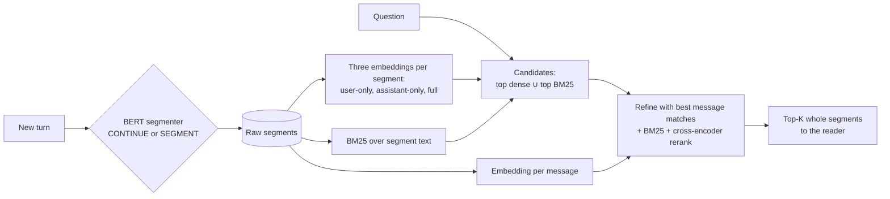

# Threader, read closely

[Threader](https://arxiv.org/abs/2609.33226) ("Beyond Memory Construction: Rethinking Memory Access for LLM-based Conversational Agents", Cai et al., Tsinghua, September 2026) is the closest published design to Long Con's retrieval. This is how it works, what to copy, and where it agrees or disagrees with choices already made in [architecture.md](../architecture.md). Read 2026-11-25.

**Short version:** copy its retrieval almost whole as the v1 baseline packet. It scores 90.6% on LongMemEval with zero LLM calls to build memory. It never tests follow-up references, multi-turn chat, rules or open loops, so it neither proves nor breaks the resolver, registers or fresh-packet bet. Its one clear weakness, preferences spread across many turns, is exactly what the rules register is for.

## How it works

### Writing: no LLM at all

- **Raw turns are the memory.** Nothing is summarized, rewritten or turned into facts.
- **Online segmentation.** A BERT-base classifier sees the current segment, a separator, and the next turn, and says CONTINUE (append) or SEGMENT (close it and start a new one). It never revisits past segments.
- **Training labels:** LongMemEval session boundaries as hard labels, plus LLM-labeled topic shifts inside sessions as soft labels. About 15K boundary examples, CONTINUE to SEGMENT roughly 4:1, five epochs on one consumer GPU.
- **Low threshold.** It splits when the SEGMENT probability passes 0.20, so it leans toward splitting.
- **Accuracy is mediocre:** boundary F1 0.483, purity 0.763, coverage 0.708. Retrieval works anyway.
- **Indexing:** each segment gets three embeddings (user messages only, assistant messages only, the full exchange) from a small shared encoder (paraphrase-multilingual-MiniLM-L12-v2), an embedding per message, and a BM25 entry.
- **Cost:** indexing 100K tokens takes 18 seconds with 0 LLM calls and $0. Mem0 needs 48 LLM calls and 20 minutes for the same, A-Mem 1,415 calls.

### Reading: hybrid, then rerank, then whole segments

1. **Query** is the raw question, embedded. No rewriting, no expansion, no special time handling.
2. **Dense score** is a weighted sum of the question's similarity to the three views.
3. **Candidates** are the union of the top dense hits and the top BM25 hits.
4. **Refine:** inside each candidate, average the best few message-level similarities, so one sharp message can lift a long segment.
5. **Fuse:** min-max normalize, then dense + β·BM25 (linear, not reciprocal rank fusion).
6. **Rerank** with a cross-encoder (bge-reranker-base), blended with the fused score.
7. **Return the top 12 whole segments** to the reader (top 8 on PersonaMem).

The weights (β, the view weights, the blend), the candidate counts and the token size of the final context are **not published.** Code is promised at `github.com/Donghua-Cai/Threader`; it didn't turn up on 2026-11-25.

## Results

| Benchmark | Reader | Threader | Next best |
| --- | --- | --- | --- |
| LongMemEval (500) | GPT-5-mini | **90.6** | EverMemOS 84.8, Self-RAG 76.6, HippoRAG2 75.0, A-Mem 67.2, Mem0 57.2 |
| LongMemEval | GPT-5-nano | **80.6** | EverMemOS 78.0 |
| PersonaMem (589) | GPT-5-mini | **69.95** | MemOS 64.7 |

LongMemEval by type (GPT-5-mini): single-session user 98.6, assistant 98.2, preference 96.7, multi-session 79.7, knowledge update 93.6, temporal 91.0. Evidence recall at top-12: 93.4% of questions have every piece of evidence retrieved.

Missing: **no full-context baseline**, no LoCoMo (sessions too short, per the authors), no multi-turn or follow-up questions. All numbers are the authors' own.

## What each piece is worth (ablations, LongMemEval, top-12)

| Change | Accuracy | Drop |
| --- | --- | --- |
| Full Threader | 90.6 | |
| No segmentation (whole sessions) | 87.0 | -3.6 |
| Fixed 500-token chunks | 85.6 | -5.0 |
| Fixed 2K-token chunks | 79.8 | -10.8 |
| Return messages instead of segments | 85.8 | -4.8 |
| No BM25 | 88.2 | -2.4 |
| No reranker | 88.2 | -2.4 |
| No dense | 84.6 | -6.0 |
| No message-level refine | 89.2 | -1.4 |
| Full-exchange view only | 84.0 | -6.6 |
| Assistant view only | 75.4 | -15.2 |

At top-5 the full system drops to 82.6, so a smaller packet costs about 8 points with this reader. Every signal adds a few points; the biggest wins are topic-sized units, returning them whole, and having all three views.

## What to copy

- **Raw spans, no LLM at write time.** Same as our lossless log. Threader is the strongest evidence that rewritten memory isn't needed for recall.
- **A tiny online segmenter.** A small classifier making CONTINUE/SEGMENT calls per turn, trained on session boundaries plus labeled topic shifts. Cheap enough for the small-model track.
- **Topic-sized retrieval units, returned whole.** Messages lose context, big chunks bury it.
- **Three views per segment plus per-message scores.** The assistant-only view matters for "what did you tell me" questions.
- **Union of dense and BM25 candidates, then a cross-encoder.** All three models are small and run on a CPU.
- **Timestamps on every span.** It scored 91 on temporal questions with no time logic, by letting the reader see the dates.

## Against Long Con's choices

| Long Con choice | What Threader says | Verdict |
| --- | --- | --- |
| **Plain retrieval baseline first, sorter must beat it** | Threader is that baseline, and a strong one | **Build it first.** Threader-style retrieval becomes packet v1 |
| **Fresh packet every turn** | Single-shot questions only; silent on multi-turn | Neutral. "Lost in multi-turn conversation" is still the evidence for it |
| **Deterministic resolver, no model call** | Raw question, no rewriting, and it works, because LongMemEval questions are already self-contained | **Supports it.** The resolver's job is to turn "multiply it by 32" into a self-contained query; once it does, plain retrieval is enough. Untested by Threader |
| **Dialogue acts tagged at write time** | Its win is 0 LLM calls at write time; systems that call an LLM per turn cost 48 to 1,415 calls per 100K tokens | **Warning.** Tag with rules, a tiny classifier, or as structured output of the reply call already being made. Never a separate model call per turn |
| **Registers (open loops, results, lists, rules)** | Its weakest spot is preferences spread across turns (63.3 on preferences with the nano reader vs 90 for EverMemOS), since raw retrieval leaves synthesis to the reader | **Supports it,** especially the rules register. Keep registers pointing at spans, so they never become lossy rewrites |
| **Sorter picks and never invents, NEW plus inbox** | No cross-time linking at all; retrieval links implicitly. Its segmenter is only 48% F1 and recall is still 93% | **Partly against.** Recall doesn't need an accurate sorter. The sorter earns its place through thread state, status lines and the sidebar, not retrieval. Keep its bar as "beats plain retrieval" |
| **Session splitter on 30-minute gaps** | Uses session boundaries as labels, not time gaps | Fine, since our sessions are display only. The gap can be a feature for the segmenter |
| **Topic window** | Leans toward splitting retrieval units (threshold 0.20) | **Not in conflict.** Over-splitting retrieval units is cheap because several come back whole. Dropping the topic window by mistake is expensive. Use fine segments for retrieval and a conservative window for the conversation |
| **Lean packet, ~3K tokens for small models** | Needs top-12 segments for 90.6; top-5 gives 82.6; token size unreported | **Against, for now.** The lean target costs recall with a plain retriever. Forced recall and registers have to make up the gap, and the evals should report accuracy against packet size |
| **Pinned rules cached** | No rules | Neutral. Keep retrieved segments after the stable prefix so caching survives |
| **Forced recall via injected tool results** | Single shot; misses some evidence in about 7% of questions at top-12 | Supports a second chance. Injection is where the missing 7% gets caught |
| **Hooks for "always X before Y"** | Not covered | Neutral |
| **Side threads anchored to the fork point** | Not covered | Neutral. A segment ID is a natural anchor |
| **"Start fresh" blocks archived material** | Retrieves everything | Easy to add. Filter blocked spans out of the candidate pool before reranking, so their slots go to something else |

## Open

- Weights, candidate counts and the context size aren't published, so tuning is ours.
- Rebuild it on our log and measure, rather than trusting the paper's numbers: same benchmark, same reader, with a full-context arm Threader never ran.
