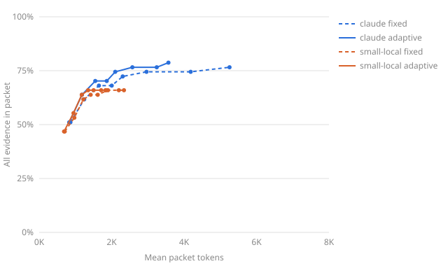

# Packet recall: LongMemEval_S dev slice

47 answerable questions of the 50-question dev slice (3 abstention questions have no evidence to find). Full history averages 139,782 tokens per question. Builder: BM25 only (no embeddings yet), size-based segments. No model calls. "All evidence in packet" means every labeled evidence turn is in it.

## Each profile at its own settings

| Profile | Budget ceiling | Evidence chats found | Evidence turns found | All evidence in packet | Mean packet tokens | Largest packet | All-evidence points per 1K packet tokens |
| --- | --- | --- | --- | --- | --- | --- | --- |
| claude | 8,000 | 94.1% | 86.2% | 78.7% | 5,700 | 7,982 | 13.8 |
| claude: plain BM25 top-k | 8,000 | 93.0% | 85.1% | 76.6% | 7,886 | 8,000 | 9.7 |
| small-local | 2,500 | 89.1% | 77.8% | 68.1% | 2,273 | 2,494 | 30.0 |
| small-local: plain BM25 top-k | 2,500 | 87.1% | 69.7% | 57.4% | 2,474 | 2,499 | 23.2 |

Plain BM25 top-k is the baseline: the same units ranked by BM25 over all words and filled to the same ceiling, with nothing else. It also shows what ranking by the user's words adds, which suits LongMemEval, where 95% of the dev slice's evidence turns are user turns, and may not carry over to real chats.

## What the reader takes in per question

System prompt, search tool definition, packet and question; then the same plus one search result. Room for the answer is kept out of the window.

| Profile | Context window | First call, mean | First call, largest | With one search, mean | With one search, largest | Fits with room to answer |
| --- | --- | --- | --- | --- | --- | --- |
| claude | 200,000 | 5,882 | 8,148 | 6,750 | 9,343 | 50 of 50 |
| small-local | 6,000 | 2,450 | 2,672 | 2,752 | 3,092 | 50 of 50 |

## Recall against packet size

### claude (segment cap 400, cutoff 0.3)

| Budget ceiling | Fixed: all evidence | Fixed: mean tokens | Adaptive: all evidence | Adaptive: mean tokens |
| --- | --- | --- | --- | --- |
| 1,000 | 48.9% | 958 | 48.9% | 922 |
| 1,500 | 61.7% | 1,455 | 63.8% | 1,377 |
| 2,000 | 66.0% | 1,959 | 68.1% | 1,849 |
| 2,500 | 66.0% | 2,456 | 68.1% | 2,273 |
| 3,000 | 70.2% | 2,943 | 72.3% | 2,678 |
| 4,000 | 72.3% | 3,948 | 74.5% | 3,424 |
| 6,000 | 74.5% | 5,940 | 76.6% | 4,725 |
| 8,000 | 76.6% | 7,894 | 78.7% | 5,700 |

Smallest ceiling within 2 points of its own 8K score: fixed 8,000, adaptive 8,000.

### small-local

Same as claude: the sweep only moves the ceiling, and both share segment cap 400 and cutoff 0.3.

## By question type

### claude

| Type | Questions | Evidence turns found | All evidence in packet | Mean packet tokens |
| --- | --- | --- | --- | --- |
| knowledge-update | 8 | 100.0% | 100.0% | 5,073 |
| multi-session | 11 | 66.7% | 45.5% | 5,858 |
| single-session-assistant | 6 | 100.0% | 100.0% | 3,079 |
| single-session-preference | 3 | 83.3% | 66.7% | 7,970 |
| single-session-user | 6 | 100.0% | 100.0% | 4,996 |
| temporal-reasoning | 13 | 82.1% | 76.9% | 6,964 |

### small-local

| Type | Questions | Evidence turns found | All evidence in packet | Mean packet tokens |
| --- | --- | --- | --- | --- |
| knowledge-update | 8 | 93.8% | 87.5% | 2,271 |
| multi-session | 11 | 64.4% | 45.5% | 2,152 |
| single-session-assistant | 6 | 83.3% | 83.3% | 2,106 |
| single-session-preference | 3 | 33.3% | 0.0% | 2,440 |
| single-session-user | 6 | 100.0% | 100.0% | 2,271 |
| temporal-reasoning | 13 | 76.9% | 69.2% | 2,416 |
